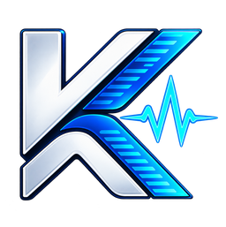

<div align="center">

  

  <h1>KuyénDev</h1>

  <p><em>Estudio Tecnológico · Desarrollo Web & Soporte Informático Profesional · Osorno, Chile</em></p>

  <p>
    <a href="https://kuyendev.cl" target="_blank">
      
    </a>
    &nbsp;
    
    &nbsp;
    
  </p>

  <p>
    
    
    
    
    
  </p>

</div>

---

## 📖 Descripción General

**KuyénDev** es el estudio tecnológico y plataforma web oficial fundada por **Franco Luna** en Osorno, Región de Los Lagos, Chile.

El proyecto está construido íntegramente sobre tecnologías web estándar nativas (HTML5 semántico, CSS3 modular vanilla y JavaScript ES6+ asíncrono sin dependencias externas ni frameworks pesados), garantizando máxima velocidad de carga (< 1s), accesibilidad universal (WCAG 2.2 AA) y resiliencia offline mediante Service Worker y PWA.

> *"Recuperar y optimizar antes de reemplazar. Tu equipo posee más potencial del que crees."*

---

## 🗂️ Arquitectura Modular del Repositorio

```
kuyendev/
├── index.html                      # Portada y catálogo general del estudio
├── 404.html                        # Página de error 404 con radar animado
├── manifest.json                   # Web App Manifest PWA con maskable icons
├── sw.js                           # Service Worker con estrategia Network-First resiliente
├── CNAME                           # Dominio de producción (kuyendev.cl)
├── sitemap.xml & robots.txt        # SEO técnico y mapa de rastreo
├── verificar_estructura.sh         # Script de verificación de integridad y rutas
│
├── assets/                         # Activos organizados sin duplicidad
│   ├── logos/                      # Logos e isotipos oficiales optimizados
│   │   └── source/                 # Archivos maestros en alta resolución
│   ├── icons/                      # Favicons y app icons de 16px a 512px
│   └── images/
│       ├── site/                   # Fotografías de portada y cabeceras
│       ├── noticias/               # Portadas de artículos y publicaciones
│       ├── casos/bertoldo-hofmann/ # Evidencias del caso institucional
│       ├── demos/                  # Previews y gráficos del catálogo
│       └── instagram/              # Infografías técnicas
│
├── css/                            # Arquitectura CSS Modular (Design System v4.0)
│   ├── main.css                    # Punto de entrada maestro (@import cascade)
│   ├── styles.css                  # Alias de compatibilidad hacia main.css
│   ├── animations.css              # Keyframes, transiciones y prefers-reduced-motion
│   ├── base/                       # Variables, reset, tipografía y utilidades
│   │   ├── variables.css           # Tokens de color, z-index y espaciado
│   │   ├── reset.css               # Reset ergonómico, scrollbar y foco accesible
│   │   ├── typography.css          # Jerarquía H1-H6 y gradientes de texto
│   │   └── utilities.css           # Contenedores, grillas y métricas
│   ├── layout/                     # Estructura visual de página
│   │   ├── header-nav.css          # Nav glassmorphism y Aurora spring dock
│   │   ├── mobile-menu.css         # Drawer lateral animado
│   │   ├── hero.css                # Hero cinemático de dos columnas y franja
│   │   ├── page-hero.css           # Hero centrado para páginas interiores
│   │   └── footer.css              # Pie de página unificado
│   └── components/                 # Componentes independientes
│       ├── buttons.css             # Sistema de botones .btn-kd y microinteracciones
│       ├── cards.css               # Tarjetas con efecto spotlight
│       ├── badges.css              # Badges de estado y pulse-dot
│       ├── forms.css               # Formularios inteligentes
│       ├── accordion.css           # Acordeones accesibles (FAQ)
│       ├── tabs.css                # Filtros interactivos de categoría
│       ├── pricing-table.css       # Tarjetas de planes
│       ├── comparison-table.css    # Matriz comparativa responsive
│       ├── portfolio.css           # Tarjetas de artículos y proyectos
│       ├── editorial.css           # Manifiesto y raíces de marca
│       ├── support-assistant.css   # Diagnóstico y checklist interactiva
│       ├── legal.css               # Tabla de contenido fija y cláusulas
│       ├── prose.css               # Tipografía para artículos de lectura
│       ├── waas.css                # Modelo Web como Servicio en 2 fases
│       ├── rubros-explorer.css     # Sistema interactivo de carpetas y demos
│       └── whatsapp-fab.css        # Botón flotante expandible
│
├── js/                             # Lógica y Configuración Frontend
│   ├── script.js                   # Interacciones UI, scroll, dock y checklist
│   ├── rubros-explorer.js          # Motor del explorador de rubros y estilos
│   ├── demo-viewer-bar.js          # Barra superior de inspección de demos
│   └── config/
│       ├── plans.js                # Especificación declarativa de planes
│       └── rubros.js               # Catálogo de rubros, paletas y estilos
│
├── pages/                          # Páginas interiores del sitio
│   ├── desarrollo-web.html         # Servicio de desarrollo web
│   ├── planes-web.html             # Catálogo de planes y WaaS
│   ├── servicios-informaticos.html # Soporte a computadores y software
│   ├── empresas.html               # Soluciones para empresas y colegios
│   ├── noticias.html               # Hub de publicaciones técnicas
│   ├── nosotros.html               # Manifiesto, raíces y fundador
│   ├── contacto.html               # Formulario inteligente hacia WhatsApp
│   ├── terminos.html               # 25 cláusulas y marco legal
│   └── content/                    # Artículos técnicos y casos de éxito
│
├── demos/                          # 60 demostraciones web interactivas
│   ├── clinica-dental/             # 20 estilos para Clínicas & Salud
│   ├── fotografia/                 # 20 estilos para Fotógrafos
│   └── peluqueria/                 # 20 estilos para Peluquerías & Estilismo
│
└── docs/                           # Documentación de ingeniería y arquitectura
    ├── architecture/               # Especificaciones técnicas históricas
    └── context-export/             # Registros de contexto y memoria
```

---

## 🚀 Verificación de Calidad

Para ejecutar la suite de comprobación de integridad de rutas, anclas y seguridad de marca:

```bash
bash ./verificar_estructura.sh
```
